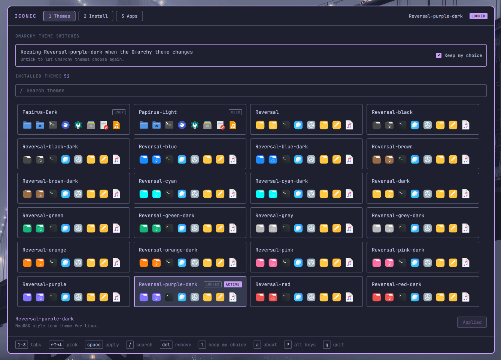
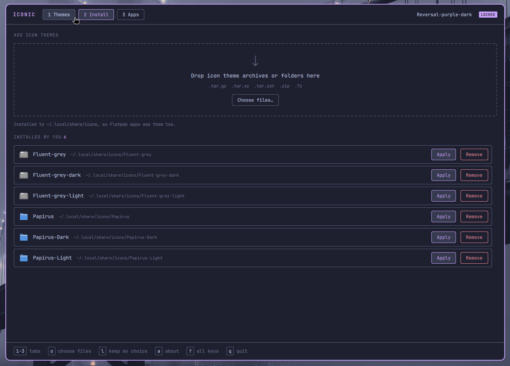
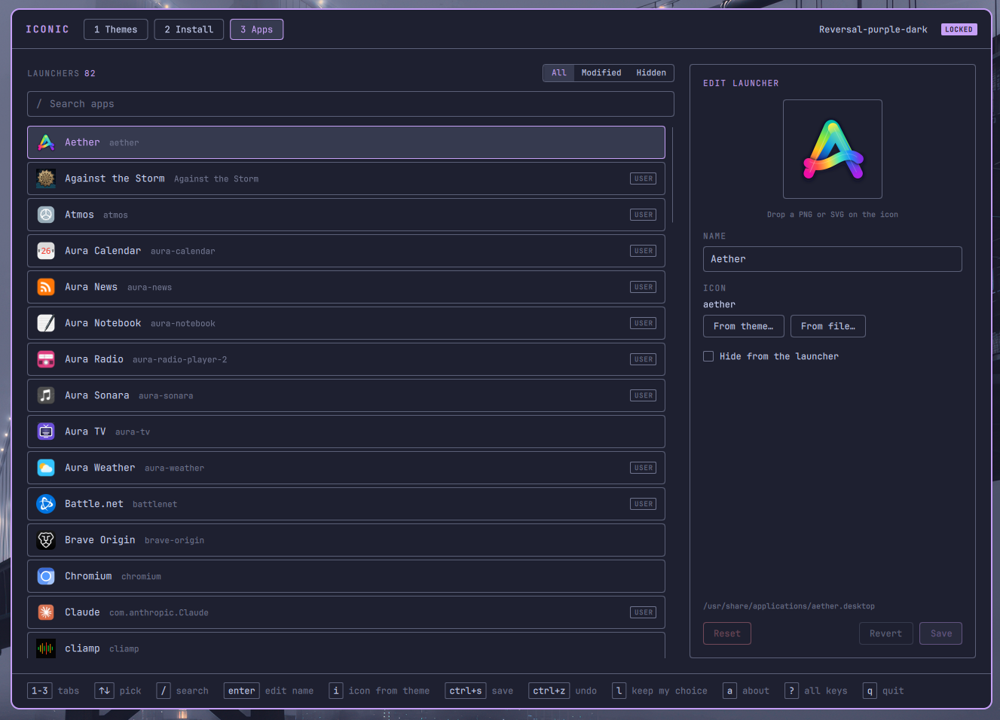

# Iconic

Change your icon theme and tidy up your app launcher in
[Omarchy](https://omarchy.org).

Iconic shows every icon theme you have side by side, so you can see what they
look like before you pick one. It also lets you rename apps, give them a
different icon, or hide the ones you never use. Nothing you change touches
the apps themselves, and every change can be undone.

It's built like Omarchy's own apps, follows your Omarchy theme, and works
with the keyboard alone.



## Pick an icon theme

Open **Themes** and pick the one you like with the arrow keys or the mouse,
then press `Space` or `Enter`. Your apps, Flatpak apps and Omarchy's launcher
and dock all switch to it. Type `/` to search when the list gets long.

Omarchy themes come with an icon theme of their own. By default, your pick
stays until you switch to another Omarchy theme, which then brings its own.
Tick **Keep my choice** (or press `L`) and your icon theme stays put, whatever
Omarchy theme you switch to. Either way it survives `omarchy update`.

## Install new themes

Downloaded a theme from [GNOME Look](https://www.gnome-look.org/browse?cat=132)
or GitHub? Drop the archive (`.zip`, `.tar.gz`, `.tar.xz`, `.tar.zst`, `.7z`)
or the unpacked folder onto the window, or open **Install** and choose the
files. Iconic finds the themes inside and installs them for you only, where
Flatpak apps can see them too.



Themes you installed are listed on the same page, with a button to apply or
remove each one.

## Change how apps look in the launcher

Open **Apps** and pick an app from the list. On the right you can:

- **Rename it**: type a new name.
- **Give it another icon**: drop a PNG or SVG straight onto the icon, choose
  one from your current theme, or pick a file.
- **Hide it**: tick *Hide from the launcher*.

Press **Save** and the launcher updates. Use the *Modified* and *Hidden*
filters to find what you've changed, and **Reset** to put an app back the way
it was. Your changes come back by themselves after `omarchy update`.



## Why app icons finally follow your theme

Omarchy's launcher and dock don't look app icons up in your icon theme. They
take the first matching icon they find from any installed theme, so switching
themes often changed your folders but not your apps.

Iconic fixes that with a small icon layer the launcher reads first, holding
one icon per app from the theme you picked (or the app's own icon when the
theme has none). It's rebuilt whenever you change your theme or an app.

## Install

```sh
git clone https://github.com/UnderStackDev/omarchy_iconic.git
cd omarchy_iconic
bin/install
```

This builds Iconic and installs it as a package. Then open **Iconic** from the
app launcher (`Super + Space`). Everything it needs already comes with
Omarchy.

Upgrading from a version before 0.2.0? The app used to be called `iconic`,
which is also the name of an unrelated app in the AUR, so `omarchy update`
could replace one with the other
([#2](https://github.com/UnderStackDev/omarchy_iconic/issues/2)). It's now
called `omarchy_iconic`. Installing it removes the old package and keeps your
settings. If the other app took its place and you don't want it, remove it
with `sudo pacman -R iconic`.

## Keyboard shortcuts

| Key | Action |
|---|---|
| `1` `2` `3` | Themes, Install, Apps |
| Arrows | Pick a theme or an app |
| `Space` / `Enter` | Use the picked theme |
| `/` | Search |
| `L` | Keep my icon theme when the Omarchy theme changes, on or off |
| `Delete` | Remove the picked theme you installed |
| `O` | Choose theme files to install |
| `Enter` | Rename the picked app |
| `I` | Pick an icon from the theme |
| `Ctrl+S` | Save the app |
| `Ctrl+Z` / `Ctrl+Shift+Z` | Undo / redo |
| `A` | About |
| `?` | All shortcuts |
| `Q` | Quit |

## Command line

Everything also works from a terminal, for scripts and dotfiles. Add `--json`
for machine-readable output.

```sh
omarchy_iconic status
omarchy_iconic list-themes
omarchy_iconic apply Papirus-Dark [--lock|--follow]
omarchy_iconic lock | follow
omarchy_iconic install ~/Downloads/theme.tar.xz [--replace|--keep-both] [--apply]
omarchy_iconic app list [--modified|--hidden]
omarchy_iconic app set firefox --name "Web" --icon web-browser [--hide|--show]
omarchy_iconic app reset firefox
omarchy_iconic shell-icons        # rebuild the launcher icon layer
```

## What Iconic changes on your system

Only files in your home folder; nothing needs administrator rights after
installing.

| Where | What |
|---|---|
| GNOME setting `org.gnome.desktop.interface icon-theme` | the icon theme (GTK apps, and Flatpak apps through the settings portal) |
| `~/.config/gtk-3.0`, `gtk-4.0`, `kdeglobals`, `qt5ct`, `qt6ct` | the same theme name, only if these files already exist |
| `~/.config/omarchy/hooks/theme-set.d/omarchy_iconic` | after an Omarchy theme switch: keeps your icon theme, or takes the new Omarchy theme's |
| `~/.config/omarchy/hooks/post-update.d/omarchy_iconic` | after `omarchy update`: puts your app changes and icon theme back |
| `~/.config/iconic/` | your settings and app changes |
| `~/.icons/iconic-apps/` | the launcher icon layer |
| `~/.local/share/icons/` | themes you install |
| `~/.local/share/applications/` | your app changes, as a personal copy of the app's launcher (marked `X-Iconic-Override=true`) |
| `~/.local/share/iconic/` | icons you picked from files, and backups |

Theme archives are checked before they're unpacked (2 GiB / 300,000 files at
most), and only files that stay inside the theme are installed.

## Uninstall

```sh
sudo pacman -R omarchy_iconic
rm -rf ~/.icons/iconic-apps ~/.config/iconic \
       ~/.config/omarchy/hooks/theme-set.d/omarchy_iconic \
       ~/.config/omarchy/hooks/post-update.d/omarchy_iconic
```

Your app changes stay until you reset them, or delete the files marked
`X-Iconic-Override=true` in `~/.local/share/applications`.

## Building from source

Iconic is C++ and Qt Quick, like Omarchy's own apps.

```sh
bin/build && build/omarchy_iconic
bin/test
```

## On GNOME?

There's a separate Iconic for GNOME:
[UnderStackDev/gnome_iconic](https://github.com/UnderStackDev/gnome_iconic).

## License

MIT © 2026 UnderStackDev. The theme and translator code follows Omacut and
Monologue (MIT, David Heinemeier Hansson).
