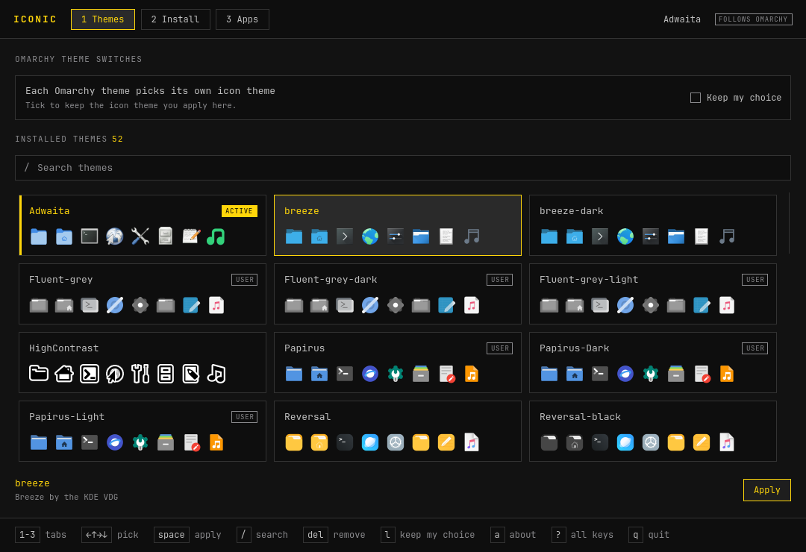

# Iconic

Icon themes and app launchers for [Omarchy](https://omarchy.org).



Iconic does three things, from one keyboard-driven window that follows your
Omarchy theme:

- **Themes** — pick the desktop's icon theme from previews of every installed
  theme, and optionally keep it when you switch Omarchy themes.
- **Install** — drop an icon theme archive or folder onto the window. It lands
  in `~/.local/share/icons`, where Flatpak apps can see it too.
- **Apps** — rename a launcher, give it another icon, or hide it, without
  touching the package's own files.

## Why app icons finally follow the theme

Omarchy's launcher and dock don't look app icons up in the active icon theme.
They index every app icon from every installed theme and keep the first file
they find per name, SVGs before PNGs. So switching the icon theme usually
changes folders but not apps, and PNG themes such as Yaru never show up in the
launcher at all.

Iconic adds a small icon layer at `~/.icons/iconic-apps` that the launcher
reads first: one SVG per launcher, taken from the chosen theme (PNG icons are
wrapped in SVG so they win), or the app's own icon when the theme has none.
The layer is rebuilt whenever the icon theme or a launcher changes, and the
launcher picks it up the next time its menu or app grid opens.

## Install

Iconic is built like Omarchy's own apps: C++ and Qt Quick, one binary,
installed as an Arch package.

```sh
git clone https://github.com/UnderStackDev/omarchy_iconic.git
cd omarchy_iconic
bin/install          # builds and installs the package (makepkg -fsi)
```

Then open **Iconic** from the app launcher (`Super + Space`).

Needs `qt6-base`, `qt6-declarative`, `qt6-wayland`, `qt6-svg`,
`xdg-desktop-portal`, `libarchive` (bsdtar), `gtk-update-icon-cache` and
`desktop-file-utils`; Omarchy has them all.

## Keys

| Key | Action |
|---|---|
| `1` `2` `3` | Themes, Install, Apps |
| Arrows | Pick a theme or an app |
| `Space` / `Enter` | Apply the picked theme |
| `/` | Search |
| `L` | Keep my icon theme across Omarchy theme switches, on or off |
| `Del` | Remove the picked theme you installed |
| `O` | Choose theme files to install (Install tab) |
| `Enter` | Edit the picked app's name (Apps tab) |
| `I` | Pick an icon from the theme (Apps tab) |
| `Ctrl+S` | Save the launcher (Apps tab) |
| `Ctrl+Z` / `Ctrl+Shift+Z` | Undo / redo launcher changes |
| `A` | About |
| `?` | All keys |
| `Q` | Quit |

## Command line

Everything also works without the window. Every command takes `--json` and
exits 0 or 1.

```sh
iconic status
iconic list-themes
iconic apply Papirus-Dark [--lock|--follow]
iconic lock | follow
iconic install ~/Downloads/theme.tar.xz [--replace|--keep-both] [--apply]
iconic app list [--modified|--hidden]
iconic app set firefox --name "Web" --icon web-browser [--hide|--show]
iconic app reset firefox
iconic shell-icons        # rebuild the launcher icon layer
```

## What it changes

| Where | What |
|---|---|
| gsettings `org.gnome.desktop.interface icon-theme` | the icon theme (GTK apps, and Flatpak apps through the settings portal) |
| `~/.config/gtk-3.0/settings.ini`, `gtk-4.0/settings.ini`, `kdeglobals`, `qt5ct`/`qt6ct` (if present) | the same theme name, one key each, everything else kept |
| `~/.config/omarchy/hooks/theme-set.d/iconic` | runs after an Omarchy theme switch: keeps your theme (Lock) or copies Omarchy's pick to the files above (Follow) |
| `~/.config/iconic/config.toml` | Follow or Lock, and the locked theme |
| `~/.icons/iconic-apps/` | the launcher icon layer |
| `~/.local/share/icons/` | themes you install |
| `~/.local/share/applications/` | launcher changes: a copy marked `X-Iconic-Override=true` for system and Flatpak apps; your own launchers are edited in place after a backup in `~/.local/share/iconic/backups/` |
| `~/.local/share/iconic/icons/` | icon files you picked for launchers |

Archives are listed before they're unpacked (2 GiB / 300,000 files at most),
unpacked by bsdtar, and only files and links that stay inside the archive are
installed.

## Uninstall

```sh
sudo pacman -R iconic
rm -rf ~/.icons/iconic-apps ~/.config/iconic ~/.config/omarchy/hooks/theme-set.d/iconic
```

Launcher changes stay until you reset them (or delete the files marked
`X-Iconic-Override=true` in `~/.local/share/applications`).

## Build and test

```sh
bin/build && build/iconic
bin/test
```

## License

MIT © 2026 UnderStackDev. The theme and translator code follows Omacut and
Monologue (MIT, David Heinemeier Hansson).
